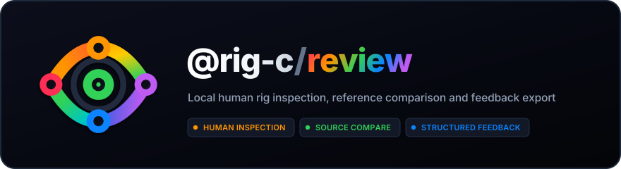

<p align="center">
  
</p>

<p align="center">
  <a href="https://www.npmjs.com/package/@rig-c/review"></a>
  <a href="https://www.npmjs.com/package/@rig-c/review"></a>
  <a href="LICENSE"></a>
</p>

<a id="review"></a>

# @rig-c/review

A local page where a person looks at an agent's rig work, answers its questions, and sends back feedback tied to the exact files they saw.

Review never edits the package it shows. Motion and mesh edits go to the installed producer as data and come back as a scratch build.

## Place in the toolchain

[Create](https://github.com/rig-c/create) drives the cycle with an agent. [Parts](https://github.com/rig-c/parts) turns a painting into parts and a rig, [Pose](https://github.com/rig-c/pose) retargets motion, [Core](https://github.com/rig-c/core) compiles the rig, and [Play](https://github.com/rig-c/play) plays it in the browser.

**Review** is where a person looks and answers. Create publishes each result and question here and reads the answers back; see the [Create choice interview](docs/WORKFLOWS.md#create-choice-interview). Review previews with Play, does not replace Core's compile check, and needs none of the published adapters (`@rig-c/pixi`, `@rig-c/phaser`, `@rig-c/three`).

## Start

If someone sent you a review link, open it in a browser.

For your own output folder, install beside the producing agent:

```sh
npm i -D @rig-c/review
npx rig-review open /absolute/path/to/output
```

`open` prints a loopback URL and exits:

```text
http://127.0.0.1:4318/?workspace=<incarnation>#cap=…
```

`rig-review` needs **Bun 1.3.0 or later** on `PATH`. `npm i -D rig-review` installs the same CLI.

`npx rig-review --help` prints usage for `open`, `control`, `feedback`, `check`, `compare` and `parts`. `strip --help` and `session --help` print their own.

The CLI and `@rig-c/review/job-host` support owner hosting. See [Public API stability](docs/STABILITY.md).

## What you can do

On a review link:

- **Answer an interview.** Pick options, write your own under Other, add a note. [Interview — WORKFLOWS](docs/WORKFLOWS.md#create-choice-interview)
- **Check parts before rigging.** `parts` shows each part as an image before any rig is built. [Parts view — PARTS_VIEW](docs/PARTS_VIEW.md)
- **Review direction.** See the scene plates and the authored camera and timing, and pin comments on the take. [Direction — REVIEW_PACKAGE](docs/REVIEW_PACKAGE.md#direction-inspection)
- **Sign off.** Approve, or Request changes with comments. Opening a link never approves anything. [Sign-off — PARTS_VIEW](docs/PARTS_VIEW.md#the-sign-off)

For the publishing agent:

- **Publish and ask.** `session open` prints a standing review link; `publish`, `ask`, `next` and `close` drive it. [Session — WORKFLOWS](docs/WORKFLOWS.md#standing-live-job-workflow)

| Task | Command or panel | Destination |
| --- | --- | --- |
| **Hand off and compare** | | |
| <a id="one-command-owner-handoff"></a>Open an inspection workspace | `open` | [Owner handoff — WORKFLOWS](docs/WORKFLOWS.md#one-command-owner-handoff) |
| <a id="existing-output-handoff"></a>Inspect existing folders | `check`, `review DIR...` | [Existing output handoff — WORKFLOWS](docs/WORKFLOWS.md#existing-output-handoff) |
| <a id="compare-two-outputs"></a>Compare two builds against a video | `compare` | [Compare two outputs — WORKFLOWS](docs/WORKFLOWS.md#compare-two-outputs) |
| <a id="feedback-ownership"></a>Retrieve submitted feedback | `feedback` | [Feedback ownership — WORKFLOWS](docs/WORKFLOWS.md#feedback-ownership) |
| <a id="frame-strip-export"></a>Export feedback intervals as strips | `strip` | [Frame strip export — WORKFLOWS](docs/WORKFLOWS.md#frame-strip-export) |
| **Inspect** | | |
| <a id="workspace-settings-and-panels"></a>Navigate the workspace | Setup, Animate, Compare, Settings | [Workspace panels — PANELS](docs/PANELS.md#workspace-settings-and-panels) |
| <a id="inspect-animation-keys"></a>Inspect stored animation keys | Timeline, Curves, Bone tree | [Animation keys — PANELS](docs/PANELS.md#inspect-animation-keys) |
| <a id="inspect-a-part"></a>Select and fit a model slot | Parts explorer | [Part inspection — PANELS](docs/PANELS.md#inspect-a-part) |
| <a id="weights-setup-pose-watch-only"></a>Inspect setup-pose weights | Weights | [Weights — PANELS](docs/PANELS.md#weights-setup-pose-watch-only) |
| Steer model turn dials and compare at one angle | Turn pad | [Turn inspection — PANELS](docs/PANELS.md#turn-pad) |
| **Edit through the producer** | | |
| <a id="chest-regions-designate-rebuild-watch"></a>Designate chest regions and rebuild | Chest regions | [Chest regions — PANELS](docs/PANELS.md#chest-regions-designate-rebuild-watch) |
| <a id="mesh-panel-density-regions-segments--remesh"></a>Rebuild a part from mesh parameters | Mesh | [Mesh parameters — PANELS](docs/PANELS.md#mesh-panel-density-regions-segments--remesh) |
| <a id="bones-config-anchors-check-rebuild"></a>Check and rebuild config anchors | Bones | [Bones — PANELS](docs/PANELS.md#bones-config-anchors-check-rebuild) |
| <a id="rig-fields-regions-still-row-stops-inherit-turn"></a>Adjust producer config fields | Rig fields | [Rig fields — PANELS](docs/PANELS.md#rig-fields-regions-still-row-stops-inherit-turn) |
| <a id="cuts-cut-polygons-patch-boxes-limb-joints--rig-parts-build"></a>Designate cuts, patches and limb joints | Cuts | [Cuts — PANELS](docs/PANELS.md#cuts-cut-polygons-patch-boxes-limb-joints--rig-parts-build) |
| <a id="mesh-edit-typed-delta-preview-only"></a>Preview a setup-space delta and rebuild | Edit Mesh | [Mesh edit — PANELS](docs/PANELS.md#mesh-edit-typed-delta-preview-only) |
| <a id="retarget-map-flags--rig-pose-watch"></a>Retarget a declared pose sequence | Retarget | [Retarget — PANELS](docs/PANELS.md#retarget-map-flags--rig-pose-watch) |
| Mark, read and edit stage comments | Comment · C (n) | [Stage comments — PANELS](docs/PANELS.md#stage-comments) |
| **Control and share** | | |
| <a id="control-the-current-inspection-page"></a>Control an opted-in inspection | `control` | [Inspection control — WORKFLOWS](docs/WORKFLOWS.md#control-the-current-inspection-page) |
| <a id="keep-and-share-an-inspection"></a>Restore a view link or local draft | View link, draft | [Keep and share — WORKFLOWS](docs/WORKFLOWS.md#keep-and-share-an-inspection) |
| <a id="launcher-contract"></a>Start or reuse the launcher | `open` | [Launcher contract — WORKFLOWS](docs/WORKFLOWS.md#launcher-contract) |
| <a id="managed-front-and-write-capability"></a>Use the owner workspace and write capability | `open` | [Owner workspace — WORKFLOWS](docs/WORKFLOWS.md#managed-front-and-write-capability) |

## License

MIT. See [LICENSE](LICENSE).

## Links

<a id="development"></a><a id="releasing"></a>
Development and releasing: [Contributing workflows](https://github.com/rig-c/review/blob/main/CONTRIBUTING.md#development).

- [Inspection workflows](docs/WORKFLOWS.md)
- [Parts and atlas view](docs/PARTS_VIEW.md)
- [Package contract](docs/REVIEW_PACKAGE.md)
- [Product design](docs/DESIGN.md)
- [Animation inspection](docs/ANIMATION_INSPECTION.md)
- [Installed-producer fixture](docs/LIVE_FIXTURE.md)
- [Agent skill](skills/rig-review/SKILL.md)
- [Live job contract](docs/REVIEW_PACKAGE.md#live-job-contract) and [standing workflow](docs/WORKFLOWS.md#standing-live-job-workflow)
